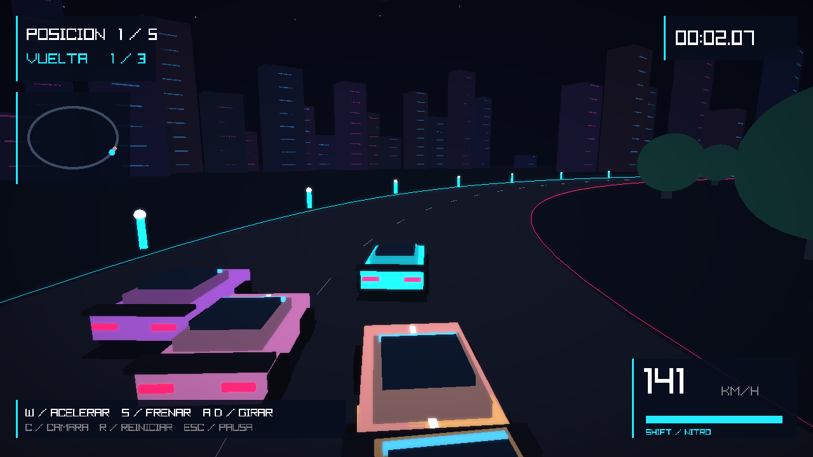

# Neon Apex — carreras 3D en C++

Primera versión jugable de un juego arcade nocturno, desarrollado con C++17 y raylib 5.5. No necesita descargar modelos, texturas ni recursos de pago: el escenario y los coches se generan por código.



Incluye un circuito urbano de tres vueltas, cuatro rivales, aceleración y frenado, contactos entre coches, penalización al salir del asfalto, nitro recargable, tres cámaras de conducción, minimapa, cronómetro y clasificación. La presentación cambia entre planos generales, primeros planos y una órbita alrededor del coche; la llegada tiene su propia cámara. El posprocesado añade resplandor y viñeta.

Es una base arcade estilizada: el coche sigue el circuito y tú controlas la velocidad y la posición lateral. No incorpora física realista, multijugador, audio, modelos detallados ni gráficos de calidad AAA.

## Windows: Visual Studio (icono morado)

1. Instala **Visual Studio 2022 Community**. En el instalador marca **Desarrollo para el escritorio con C++**, con las herramientas de CMake y un Windows SDK.
2. Descarga o clona este repositorio y abre su carpeta con **Archivo → Abrir → Carpeta**. Debe contener `CMakeLists.txt`.
3. Espera a que termine la configuración de CMake; la primera vez requiere Internet para descargar raylib desde GitHub.
4. Selecciona `neon_apex.exe` como destino de inicio y ejecútalo con **Ctrl + F5**.

También puedes abrir la **Developer PowerShell for VS 2022**, ir a la carpeta del proyecto y ejecutar:

```powershell
cmake -S . -B build
cmake --build build --config Release --parallel 4
.\build\Release\neon_apex.exe
```

## VS Code (icono azul)

En Windows instala primero las herramientas C++ de Visual Studio indicadas arriba. Abre la carpeta del proyecto en VS Code e instala las extensiones **C/C++** y **CMake Tools** recomendadas por el proyecto. Ejecuta **CMake: Configure**, selecciona un compilador instalado, luego **CMake: Build** y **CMake: Run Without Debugging**. No uses el botón de ejecutar un archivo `.cpp` aislado: el proyecto necesita enlazar raylib.

## Linux

Con compilador C++, CMake, Git y las bibliotecas de desarrollo de X11/OpenGL instaladas:

```bash
# Debian / Ubuntu: instalación de requisitos, con permisos de administrador
sudo apt-get install build-essential cmake git libx11-dev libxrandr-dev libxinerama-dev libxcursor-dev libxi-dev libgl1-mesa-dev
cmake -S . -B build -DCMAKE_BUILD_TYPE=Release
cmake --build build --parallel 4
./build/neon_apex
```

Se necesita una sesión gráfica y soporte OpenGL 3.3. Este entorno cloud compiló el juego y ejecutó una prueba gráfica con Xvfb y Mesa; el ejecutable Linux generado no es un `.exe` para Windows. La compilación en Windows todavía no se ha verificado.

## Controles

| Tecla | Acción |
| --- | --- |
| Enter | Comenzar / volver a correr |
| W / flecha arriba | Acelerar |
| S / flecha abajo | Frenar |
| A, D / flechas laterales | Moverse a los lados de la pista |
| Shift | Nitro mientras aceleras |
| C | Cambiar cámara |
| Espacio | Saltar la presentación |
| Esc | Pausar / continuar; salir desde menú o llegada |
| R | Reiniciar carrera |

## Validación

```bash
ctest --test-dir build -C Release --output-on-failure
```

La prueba sin ventana simula aceleración, vueltas, consumo de nitro, frenado, límites de carril, llegada, clasificación y reinicio. `neon_apex --smoke` abre una ventana, recorre automáticamente menú, presentación, cuenta atrás y conducción durante 240 fotogramas, guarda `neon-apex-smoke.png` en el directorio de trabajo y termina. Para esta prueba gráfica hace falta una pantalla real o virtual.

Código principal: `src/main.cpp`. Configuración de compilación: `CMakeLists.txt`.

Repositorio original: 4444, deyvis.
